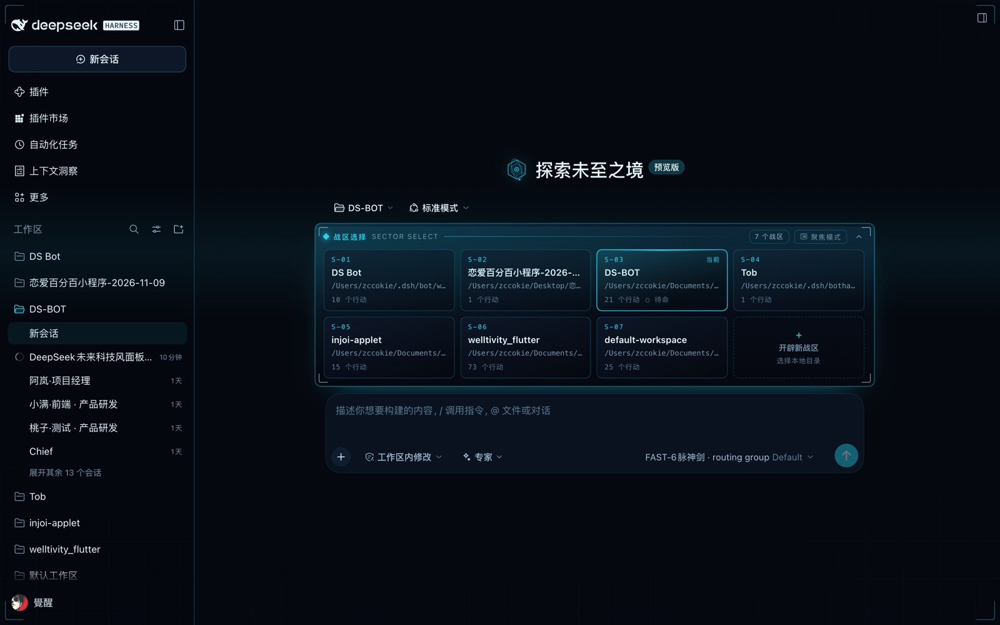

# Future Command Deck

A sci-fi command-deck skin for the DeepSeek Harness web shell. It replaces the
stock shell chrome with a console layout, and adds three functional panels that
the stock shell does not have.



## Install

```sh
# from GitHub (restart DSH afterwards)
dsh plugin --profile desktop add github:zccokie/dsh-future-command-deck

# uninstall
dsh plugin --profile desktop remove dsh-future-command-deck
```

The bundle registers one inert Host row and one browser-side client plugin, so it
works on any Harness 0.2.1-rc.2 or later. Disabling it in **Settings → Plugins**
removes everything it added: the mode attribute on `<html>`, the injected
stylesheet and every slot entry.

## What it adds

- **Focus mode (default on).** Only the content column stays visible; both
  sidebars and the session title row are hidden, and a 26px draggable strip is
  kept at the top so the macOS window can still be moved. A button in the panel
  header toggles back to the full three-column shell. The choice is remembered in
  `localStorage['fcd.focus']`, and a fallback capsule appears when no panel is on
  screen, so the sidebars can never become unreachable.
- **Sector select.** On a blank session, the area above the composer becomes a
  deck of workspace cards (index, path, session count, status light). Clicking a
  card switches the workspace; a dashed card opens a new one from a local folder.
- **Live ops panel.** While a session runs, the deck above the composer shows
  status, elapsed time, workspace, session id and task progress (projected from
  the todo list, falling back to the goal). It collapses to a single line.
- **Session dock (top right).** Lists only the sessions that are still running or
  waiting for confirmation, newest activity first, with a breathing status light.
  A finished session removes its own row. Clicking a row opens that session.
- **Sector sessions panel (top left).** Every session of the current workspace,
  with status dot, title and compact relative time; clicking one switches the main
  area to it.
- **Cyber compass.** Inside a session, a `Content | Compass` capsule switches the
  second view of the session panel: a canvas compass drawn the traditional way
  (360° ring, 24 mountains, eight trigram palaces, an outer dial that turns while
  the needle stays fixed to north-south). Each tool call turns the dial to the
  palace that tool belongs to (read = Kan, write = Gen, shell = Zhen, search =
  Xun, network = Li, plan = Kun, helper = Dui, haul = Qian), leaves a short
  afterglow and bumps a lap counter when a turn ends. The dial can also be
  dragged and flings; it snaps to the nearest mountain. All motion is disabled
  under `prefers-reduced-motion`.
- **Theme token layer.** Overrides roughly 55 `--dsw-alias-*` tokens in both the
  dark ("deep space cyan") and light ("ice-lab blue") palettes, plus a glass
  surface layer that is applied in focus mode only, so settings pages and dialogs
  keep the stock solid backgrounds.

## Privacy and network

The only network request the plugin makes is to `https://v1.hitokoto.cn` for the
sentence shown next to the compass: six quotes are fetched in parallel, cached in
`localStorage['fcd.notes.quotes']` for six hours, and a local pool of 16 quotes is
used when the request fails, is blocked, or the browser is in private mode. The
request carries no session content. Session text is read only through the host's
own `session/events` channel, is not stored by the plugin, and is never sent
anywhere.

## Files

| File | Role |
| --- | --- |
| `package.json` | bundle manifest: `dsh.bundle.patch` + `dsh.client` (web / immediately) |
| `cordis.patch.yml` | inserts one loader row |
| `index.js` | Host half, inert (everything is rendered in the browser) |
| `client.js` | browser half: theme layer, styles, slot registrations, components |
| `locale/{zh,en}.json` | UI strings and the `meta.title` / `meta.description` shown by the plugin manager |
| `screenshots.json` | the screenshots shown by storefronts |
| `README.md` | full Chinese notes, including implementation details |

## License

MIT
