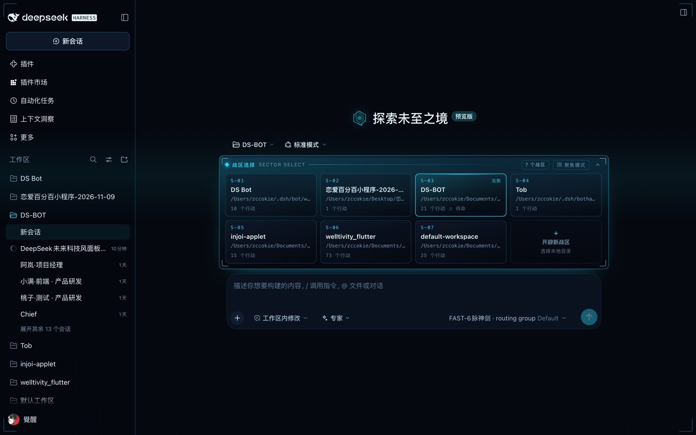
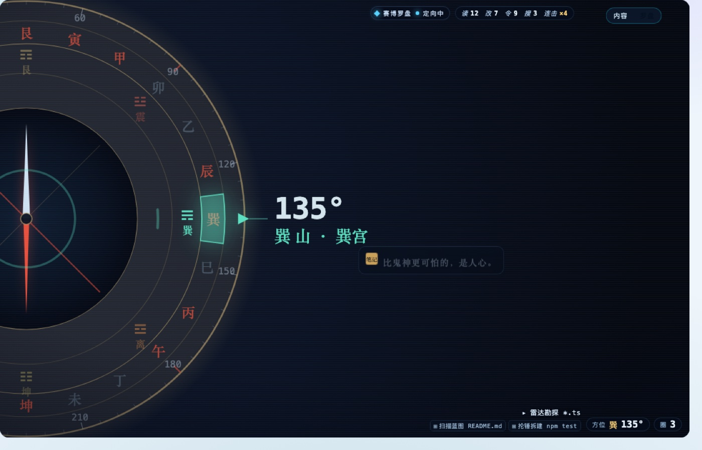

# 未来指挥舱 · Future Command Deck

把 DeepSeek Harness 的 Web 界面改造成未来科技感的指挥台：




## 安装

```sh
# 从 GitHub 安装（装完重启 DSH）
dsh plugin --profile desktop add github:zccokie/dsh-future-command-deck

# 卸载
dsh plugin --profile desktop remove dsh-future-command-deck
```

`desktop` 是桌面版使用的 profile 名；如果你在命令行里自己起 DSH，换成你自己的 profile 名（如 `--profile web`）。

装好后进入 **设置 → 插件** 里能看到「未来指挥舱 / Future command deck」，界面自动换成指挥舱皮肤；
想回原生界面，在插件页停用它即可（它卸载时会把 `<html>` 上挂的属性与样式全部摘掉）。

更多截图：[聚焦模式](assets/screenshots/02-focus-mode.jpg) ·
[执行中会话坞](assets/screenshots/03-session-dock.jpg) ·
[浅色主题](assets/screenshots/04-light-theme.jpg) ·
[赛博罗盘](assets/screenshots/05-cyber-compass.jpg)

## 特性

0. **聚焦模式（默认）** — 启动时只保留中间内容列：左栏、右栏、会话标题/标签行全部隐藏，
   顶部留一条 26px 的可拖动窗条（macOS 拖窗口靠它）。面板右上角有一个「完整界面 / 聚焦模式」
   切换按钮，随时切回原来的三栏布局；选择记在 `localStorage['fcd.focus']`。
   不在会话页时（没有面板可点），HUD 右上角会出现一枚回退胶囊，保证永远不会被困住。
1. **执行面板（Running Dock，右上角，仅主战区）** — 只在主战区界面当值：一旦进入某个会话，
   面板整体隐藏，**输出交还主区域**。
   面板只装**正在进行**的会话，是一张「谁在跑」的实时看板，**纯导航**：点任意一行 → 直接跳进
   那个会话（`uiWorkspace.openSession()`，同时把该会话 pin 成 `live`）。
   - **跑完就移除**：过滤条件是 `running === true || pendingInteraction !== undefined`
     （后者= 暂停在等你确认，任务还没结束）；会话一结束，那一行自己消失。
     列表空了整块面板就不渲染，右上角不会留一块空壳。
   - 排序：真在跑的绿色呼吸灯排最上，等确认的（琥珀色点、不呼吸）排后面，同组按
     `summary.updatedAt` 倒序。上限 8 行（`buildRecentSessions({ limit: 8 })`）。
   - **每行只有三样东西**：标题 / 所属项目（战区名）/ 相对时间；长标题用省略号，
     完整「标题 · 战区」放在原生提示气泡里。
   - **不读会话日志**：原来每行会经 Gateway Remote 的 `session/events` 读该会话最新一页日志、
     折成轮次后整段渲染（Markdown + 默认折叠的「思考过程」块）。这一整套已撤掉，
     要看对话点一行进主区域就行。读取链路（`resolveRemote()` / `readSessionTurns()` /
     `foldSessionRecords()` / `renderMarkdown()` / `.fcd-md` 样式）代码保留但当前没有挂载点。
   - 主内容区始终居中，面板是浮层，不占布局；手动收起后，只要还有会话在跑，右上角就留一枚
     「执行中」胶囊可以恢复（没有进行中的任务时这枚胶囊也不出现）。
   - 已结束的历史会话去哪找：左上角「战区会话」列出**当前战区**的全部会话；要翻别的战区，
     先在战区选择里切过去。
2. **战区会话面板（左上角）** — 切到某个战区（= 主视图所在的工作区）后，左上角列出**该战区下的全部会话**：
   状态点 / 标题 / 紧凑相对时间（`刚刚 / 5分 / 3时 / 2天 / 11/10`，等宽数字右对齐，`shortAgeLabel()`），
   当前会话用青色标题 + 左侧强调条；可折叠。**点某一条 → 切到主执行区**（`uiWorkspace.openSession()`）。
3. **战区选择（Sector Select）** — 空白新会话时，输入框正上方是一块全宽的「战区」选择舱，
   每个工作区是一张带编号（S-01…）、路径、行动数、状态灯的战区卡片；
   点卡片是**选中该战区**（`uiWorkspace.openWorkspace()`）：左上角工作区 chip 立刻跟着变，
   主视图进入该战区的新会话界面（仍是战区选择界面，不会切到别的对话）；
   仍在跑的会话留在右上角「执行中」面板里，点那一行才放大。
   还有一张「开辟新战区」虚线卡片，直接选本地目录建新工作区。
4. **会话输出面板（仅聚焦模式）** — 在某个战区的具体会话里时，主区域的聊天流被包成一块玻璃面板
   （`:has(> [data-slot="conversation.chat.flow"])` 选中聊天列，圆角 14px、`backdrop-filter: blur(20px)`、
   内描边 + 外发光），和战区舱/执行面板同一套面板语言；主战区界面不受影响（靠 `<html data-fcd-mode>` 区分）。
   卡片还开了 `overflow-x: clip` + `isolation: isolate`：宽表格 / 代码块 / 长 URL 会横向溢出圆角，
   原来会从面板左右两边「穿」出去；clip 不产生滚动容器、也不动竖向，内部滚动与 sticky 代码条不变。
   **完整界面下不显示**：左右两块浮层面板与会话输出卡片都只挂在 `html[data-fcd-focus]` 下，切到完整三栏即整体隐藏。
4b. **面板双视图：内容 / 罗盘** — 在聚焦模式下进入某个具体会话后，会话面板右上角有一枚
   「内容 | 罗盘」胶囊（位置在两种视图里保持一致，切回来不用找）。选「内容」就是原来的聊天流；
   选「罗盘」时聊天流只做 `visibility: hidden`（布局尺寸一点不动，宿主的滚动、流式追加、
   自动贴底全部照旧），同一块矩形上盖一台 canvas **赛博罗盘**，跟着工具调用自动转，不用点。
   - **按古制罗盘画**（从外到内）：度数圈（0–360 刻度，30° 一标）→ **二十四山**（子癸丑艮寅甲卯乙
     辰巽巳丙午丁未坤申庚酉辛戌乾亥，每山 15°，阳山朱笔、阴山墨色）→ **后天八卦八宫**
     （☰☱☲☳☴☵☶☷ 卦符 + 卦名）→ **天池**（池壁、子午红线、磁针）。
   - **可以用鼠标拖盘**：画布吃指针事件（`cursor: grab` / 拖动时 `grabbing`，`touch-action: none`），
     按住拖动时盘面按指针绕盘心的角度差跟手转（走最短路径，靠近盘心 12% 半径内的移动忽略，避免乱跳），
     松手后**吸附到最近的二十四山**（15° 一格），然后照旧定住 4.5s 再慢慢巡航。
     面板其余部分仍是 `pointer-events:none`，只有画布和切换胶囊吃事件。
   - **磁针固定、盘面转**：磁针在屏幕空间永远指南北（钢针朝上为子、朱红半截朝下为午），
     内盘绕它转——这就是罗盘的用法。盘面转 `-bearing`，让当前那一**山**落在右边固定索引上。
   - **工具 → 八宫**（`PALACES`，每 45° 一宫，正好是二十四山里的四正四维）：
     读=坎宫/子、改=艮宫/艮、令=震宫/卯、搜=巽宫/巽、网=离宫/午、计=坤宫/坤、协=兑宫/酉、搬=乾宫/乾。
     索引读数 = 「度数 + 山名 + 宫名」，例如 `135° 巽山 · 巽宫`。
   - **默认慢转、有调用就定位**：没有事件时盘面以 5°/s（待命时 2.5°/s）缓缓巡航；
     一次工具调用到来，目标方位立刻切到对应那一格，弹簧（刚度 55 / 阻尼 12）带着一点过冲摆过去，
     然后定住 4.5s（`IDLE_HOLD_MS`）让人看清读数，之后继续慢转。实现在 `step()`：
     巡航推的是**目标角**、弹簧跟在后面，所以快慢变化都是连续的，不会跳。
   - **怠速外扩光效**：慢转期间每 2.2s 从盘心往外荡一圈柔光（波前细环 + 贴波前的渐隐光带），
     一直扩到盘沿之外再淡掉，颜色取当前所在宫的颜色；一来工具调用就停，换成到位脉冲。
     实现：`waves` + `drawWaves()`，常量 `IDLE_WAVE_SECONDS` / `IDLE_WAVE_LIFE`。
   - 每次到山，那一格留下 2.4s 同色余辉、从轴心荡一圈脉冲；`turn/end` 时整盘扫过一圈、圈数 +1；
     工具报错则被撞一下（盘中反向抖）。`prefers-reduced-motion` 下不巡航、不抖。
   - HUD：定向中/待命、读/改/令/搜四类计数、连击、方位（山名 + 度数）、圈数、当前动作 +
     最近三条流水；HUD 整体靠右，左半留给盘面。
   - **面板尺寸固定、且跟着窗口自适应**：`readPanelRect()` 只用稳定锚点——左右上取聊天卡片，
     下取输入区 `[data-composer-seat]`（和执行面板）上沿减 `PANEL_CHROME_GAP`。**不用卡片高度**
     （卡片随内容会一直长），输入区还没渲染时宁可先不画。变化靠三路触发：`window.resize` 事件、
     `ResizeObserver` 盯住聊天列与输入区座位、以及 400ms 的兜底轮询；三者都合并到一帧 rAF 里量一次，
     量到就立刻应用（0.5px 以内不动），所以拖大窗口时面板是跟着长的。
   - **罗盘旁边的句子**：任务运行中每 7 秒换一句《盗墓笔记》里的话；句子池 = 本地 16 句底库
     + 本地缓存 + 一言 API 动态补的新句子（见下面「笔记话术池」）；

     一轮任务结束（会话从「执行中」转「待命」）时换成朱印的「发现 / 墓门开了——下面那一层，还没人进去过。」，
     停 9 秒后回到轮换；待命且没有「发现」时整张卡片淡出（`data-hidden`），不打扰画面。
   - **拖盘惯性**：拖动时按最近 ~110ms 的采样估算松手角速度（`flingVelocity()`），超过 70°/s 就进入滑行
     （`spin`，指数摩擦 1.9/s）；慢到 24°/s 以下把残余速度交给弹簧，并吸附到最近的一山（15° 整数倍）。
     轻轻一拖仍直接吸附；`prefers-reduced-motion` 下不滑行。常量：`SPIN_FRICTION` / `SPIN_STOP_DEG_PER_SEC` /
     `FLING_MIN_DEG_PER_SEC` / `FLING_SAMPLE_MS`。
   - 数据：只在**画面可见且会话在页面上**时才通过 Gateway Remote（`session/events`）读会话日志，
     首次只「铺底」（把已有计数/圈数算好、盘面直接就位，不回放历史），之后按 `seq` 增量推进。
     读不到就退避重试，画面照常空转；**连续两次读失败**时头部胶囊里会多一块「断流」提示。
   - **日志读取必须在注入作用域里拿**：Cordis 拒绝在没有 `inject` 的作用域里访问
     `ctx.get('remote').session`，所以 `apply` 里用 `ctx.inject(['remote', 'remote.session'], …)`
     捕获命名空间（`bindSessionLogNamespace`），组件只从 `sessionLogNamespaceRef` 读。
   - **切换胶囊按「按下」生效**：`onPointerDown` 就切，不等 `click`。面板尺寸/位置每 400ms
     会重算一次，万一胶囊在按下与抬起之间挪了几像素，浏览器就不再派发 click —— 表现就是
     「有时候点不动」。键盘（Enter/Space，合成 click 的 `detail === 0`）保留一条通路。
     另外量不到面板时**保留上一帧**（不再把整层卸掉），胶囊不会跟着闪没。
   - **整颗胶囊都可点**：两个按钮 `flex:1` 铺满胶囊、中间不留缝；胶囊本体（圆角内边距）也绑了
     `onPointerDown`，落在缝上会直接切到另一侧；容器与按钮都是 `cursor:pointer`。
     之前的死区就出在「按钮只覆盖文字+内边距、缝和圆角属于容器」——看起来只有点在字上才灵。
   - **遮挡自检**：每秒用 `document.elementFromPoint` 验一次胶囊中心点；被别的浮层压住就
     ① 抬到 `z-index:9999` 并往左让 132px，② 在面板右下角再挂一枚同样的胶囊，
     ③ 控制台 `console.warn` 打出遮挡者（`tag.class[data-slot]`），便于定位是哪个插件。
   - **胶囊位置**：面板右上角内缩 **44px**、上边距 12px，HUD 顶部那排再留 `padding-right:172px`，
     两者之间留出干净的空白——贴边容易被窗口边缘的手柄/滚动条或其他浮层压住，也容易和统计条挤在一起。
   - **切换胶囊挂在根层**（`.fcd-arenaRoot` 的直接子元素，`z-index:6`），不进面板内部：
     面板有 `overflow:hidden`、上面还压着画布 / 扫描层 / 句子卡，胶囊放里面一旦层叠出岔子
     就点不动。面板本身现在是 `pointer-events:none`（纯展示层），所以任何子元素都不可能
     再截走胶囊的点击。
   - 选择记在 `localStorage['fcd.view']`；`<html>` 上的 `data-fcd-view` 是样式表的开关。
5. **实时执行面板（Live Ops）** — 打开一个**已有对话**的会话时，输入框上方显示执行面板（与输入框同宽居中）：
   执行中/待命状态灯、运行时长走秒、当前战区、会话编号、任务进度条（todo 投影，无清单时回退 goal 目标），
   外加「⌂ 主战区」按钮一键回到默认新会话界面。面板可折叠成单行摘要。
   **在主战区里发消息 = 发射一个任务**：首轮被宿主受理的那一瞬间，主视图自动回到**同一个战区**的
   空白新会话（战区选择界面原样不动，输入框清空，不会出现聊天输出），任务本身留在右上角「执行中」面板里跑，
   坞会自动把「执行中」那条排到第一行并展开它的逐轮输出。
   `deckModeOverrides` 仍把这类会话钉在 `sector` 模式；只有从左上/右上面板**显式点开**某个会话时
   才 pin 成 `live`（对话界面 + 实时执行面板）。
   **发射转场**：宿主把发送中的会话切成「对话」版式的那一帧，插件用 layout effect 立刻给
   `<html>` 挂上 `data-fcd-launching`，把整个内容列压到透明（并关掉过渡），跳变那一帧完全
   画不出来；新战区的空白会话就位后（`LAUNCH_FADE_HOLD` = 220ms 后）再淡入 180ms，
   观感是一次跃迁而不是「页面跳一下」。1.2s 硬超时兜底，任何情况下都不会停在空白。
   **执行中光晕**：`running` 为真时卡片根节点带 `data-running="true"`，CSS 只认这一个稳定属性，长出两样东西：
   - 一圈 **2.6s 呼吸的外发光**（`fcd-deckHalo` 在两套 `box-shadow` 之间插值；外发光画在卡片盒外，
     不受卡片 `overflow:hidden` 影响——那条只裁子元素）。
   - 一道 **3.8s 绕边框跑的扫描光**：`::after` 用「双层遮罩求差」(`mask-composite:exclude`) 只留 1px 的环，
     `@property --fcd-sweep` 把 `conic-gradient` 的起始角从 0 推到 360deg。不支持 `@property` 的容器
     角不会动，退化成静态高光边，不报错也不闪。
   - `prefers-reduced-motion: reduce` 下两条动效一起关掉（已并入现有的降级块）。
   - 主战区界面上这张卡片通常读的是空白会话的状态（`running === false`），所以光晕实际只在实时执行面板亮。
6. **全屏 HUD 装饰** — 只剩背景网格（扫描光带与四角括线都已去掉），`pointer-events:none`，不挡任何点击。
7. **英雄区徽标** — 空白会话标题前的鱼形标记换成六边形瞄准徽标（带轨道环旋转）。
8. **主题令牌层（透明玻璃）** — 覆盖 ~55 个 `--dsw-alias-*` 令牌：深色为「深空青」，浅色为「冰蓝实验室」，
   浅/深两套配色都写了，跟随用户主题偏好切换。
   `--dsw-alias-bg-base` 改成 `transparent`，画布渐变画在 `:root` 上（深/浅两套用
   `:root:has(body[data-ds-dark-theme])` 切换），面板/输入框等表面令牌用带 alpha 的玻璃值，
   `.fcd-deck` 与 `.fcd-dock` 再叠 `backdrop-filter: blur(20px)`。
   - **底部输入区是毛玻璃**：宿主在对话版式里给输入区座位铺的淡出遮罩依赖
     `--dsw-alias-bg-base`，而本皮肤把这个令牌改成了 `transparent` —— 遮罩于是变成
     「透明 → 透明」，正文会一直滚到输入框底下、从玻璃卡片后面透出来。插件不补不透明
     底色（那会在画布上压出一块死板色块），而是把整块底部做成毛玻璃：
     `[data-composer-seat]` 自己做 `backdrop-filter: blur(18px) saturate(1.25)`，
     把滚到它下面的正文磨砂掉；`::before` 再叠一层向下渐浓的 `--dsw-alias-bg-layer-1`
     半透明，配 30px 淡入蒙版，过渡是渐显而非一刀切。
     - blur 必须挂在座位本身、不能挂 `::before`：座位带 `will-change:transform`，
       对子元素来说是 backdrop root，挂在子元素上会「滤不到」后面真正的正文。
     - 生效条件沿用宿主那份规则的前提：`[data-phase="active"]`（对话版式）或
       `[data-content-phase="active"]`（右侧栏内嵌对话）。
9. **完整界面不套玻璃** — 半透明表面令牌（`--dsw-alias-bg-base` / `bg-layer-*` / 菜单、气泡、
   Markdown 代码块、toast、输入框等）拆成**独立的一层**（`GLASS_TOKENS`），
   只在聚焦模式（`html[data-fcd-focus="1"]`）挂上去；切到完整界面时撤掉这一层，
   设置页、插件页、各种弹窗回到宿主原本的**实心**背景，不再透出画布底色。
   品牌色、描边、文字、状态、按钮这些不透光的令牌（`THEME_TOKENS`）始终生效，
   所以两边的配色仍然是一套。为此新增 `syncGlassTokens`：`applyFocusAttribute()`
   切换聚焦模式时会一起挂/摘玻璃层。完整界面里连装饰网格 `.fcd-hudGrid` 也一并隐藏。


## 笔记话术池（罗盘旁的那句话）

- **本地底库**：`RUN_QUOTES` 里 16 句《盗墓笔记》台词（前 4 句是面板最早那几句，永远排最前），离线也永远有句子可转。
- **联网补充**：`refreshNotesQuotes()` 去一言 API（`https://v1.hitokoto.cn/?c=d&c=h&c=i&c=k`，CORS 全开）
  并行取 6 句，带「墓/青铜/长白/十年/起灵…」等字眼的优先，追加进池子并写 `localStorage['fcd.notes.quotes']`；
  池子上限 60 句，缓存 6 小时过期，页面加载与打开面板时都会检查一次。
- **降级**：断网 / 跨域被拦 / 隐私模式 → 静默留在本地底库，不报错；整批请求有 7s 硬超时，不会卡住。
- 台词整理自公开语录：[知乎·盗墓笔记经典台词](https://zhuanlan.zhihu.com/p/313011468)、
  [知乎·盗墓笔记经典语录](https://zhuanlan.zhihu.com/p/364332784)、
  [B站·盘点盗墓笔记经典语录](https://m.bilibili.com/opus/480563830624698218)。

## 本地开发

作者本机以链接目录方式安装（bundle 行 id `future-command-deck`），改动本目录文件后刷新页面即可生效：

```sh
dsh plugin --profile desktop add link:/path/to/dsh-future-command-deck
```

## 文件

| 文件 | 作用 |
| --- | --- |
| `package.json` | bundle 清单：`dsh.bundle.patch` + `dsh.client`（web / immediately） |
| `cordis.patch.yml` | 插入一行 loader entry |
| `index.js` | Host 半边，空实现（所有渲染都在浏览器侧） |
| `client.js` | 浏览器半边：主题层 + 样式 + 三个槽位注册 + 组件 |
| `locale/zh.json`、`locale/en.json` | 界面文案与 Plugin Manager 显示用的 `meta.title` / `meta.description` |
| `icon.svg`、`assets/icon-180.png` | 插件图标（SVG 源 + 市场卡片用位图） |
| `screenshots.json` | 市场详情页截图清单（指向 `assets/screenshots/`） |
| `locale/`、`LICENSE` | 文案与 MIT 许可 |
| `screenshots/` | 开发期原图（未入库，见 `.gitignore`） |

## 聚焦模式的实现

- 开关是 `<html data-fcd-focus="1">`，`apply` 时按存储值挂上，插件卸载时摘掉——摘掉即 100% 回到宿主原样。
- 隐藏规则写在样式表里，只用宿主稳定的 `data-*` 属性：`[data-slot="sidebar"]`、`[data-slot="rightbar"]`、
  `[data-side="sidebar"]`、`[data-side="rightbar"]`，以及 `div:has(> [data-shell-overlay])` 这个三栏 frame；
  栏宽用 `grid-template-columns:0 minmax(0,1fr) 0 !important` 覆盖内联 grid。不碰任何哈希类名。
- 会话标题栏不整块删掉：它是 macOS 的窗口拖动区（`header[data-window-drag]`），
  所以保留 26px 窄条、只把里面的标题/标签/工具隐藏。
- 兜底：`HudOverlay` 用 MutationObserver 观察「聚焦开关 + 页面里有没有 `.fcd-deck`」，
  只有在「聚焦中但没有面板」时才渲染右上角回退胶囊，正常会话页不会出现重复按钮。

## 注册点（槽位）

| 槽位 | 用途 |
| --- | --- |
| `conversation.input.dock`（order `-10`） | 战区选择 / 实时执行面板，位于输入框卡片正上方 |
| `shell.overlay`（order `870`） | 左上角战区会话面板：当前工作区的全部会话，点击切到主执行区 |
| `shell.overlay`（order `880`） | 右上角执行面板：**只列正在进行的会话**（跑完自动移除），点击跳转 |
| `shell.overlay`（order `890`） | 面板双视图：内容/工地切换 + 赛博工地画面（仅聚焦模式 + 具体会话） |
| `shell.overlay`（order `900`） | 全屏 HUD 装饰层（只剩网格） |
| `conversation.hero.brand.mark`（single） | 空白会话标题前的徽标 |

数据全部来自槽位自带的标准 hooks，不直读 DOM、不订阅会话日志：

- `useSession((s) => s.blank)` → 决定「战区选择」还是「执行面板」
- `useWorkspaces((s) => s)` → 战区列表、加载阶段、当前会话属于哪个战区
- `useSessionStatus((s) => s.get(sessionId)?.running)` → 执行中/待命
- `useProjection('todos')` / `useProjection('goal')` → 任务进度与目标
- `ctx.get('uiWorkspace')` → `connectWorkspace()` 停靠、`openSession()` 放大、`pickDirectory()` 选目录
- `useSessions((s) => s.projectionsBySession)` → 执行面板的 `preview` 字段（`values.turnOutline`）；
  窄版行不再渲染它，仅保留给将来的正文块
- `ctx.get('workspaces')` → `create({ path })` 建新战区
- `readSessionRecordPage()`（`remote.session.events` 一页日志）→ **只有赛博工地画面在用**：
  把 `tool/call`、`tool/ptc-dispatch`、`tool/result`、`turn/end` 折成画面动作（`foldToolSceneEvents`）

## 常改的地方

- **配色**：`client.js` 的 `THEME_TOKENS`，每个令牌都是 `{ light, dark }`，两边都要给。
- **罗盘 · 工具映射**：`TOOL_ACTION_RULES`（工具名归一化后按正则归类到
  read / build / smash / scan / drone / flag / helper / haul），未知工具落到 `haul`（乾宫）。
- **罗盘 · 圈层**：`MOUNTAINS_24`（二十四山顺序）、`YANG_MOUNTAINS`（哪些用朱笔）、
  `PALACES`（八宫的角/卦/山/颜色，**工具朝向的唯一来源**，改这里就是改罗盘的含义）。
- **罗盘 · 句子**：`RUN_QUOTES`（轮换的几句）、`FOUND_QUOTE`（结束那句）、
  `QUOTE_INTERVAL_MS`（7s）、`FOUND_HOLD_MS`（9s）；样式在 `.fcd-arenaQuote`。
- **罗盘 · 怠速光效**：`IDLE_WAVE_SECONDS`（间隔 2.2s）、`IDLE_WAVE_LIFE`（一圈活 2.8s）、
  亮度在 `drawWaves()` 里（波前 0.46、光带 0.20，乘衰减）。
- **罗盘 · 拖盘**：`pointerDown/pointerMove/pointerUp`（引擎导出，坐标是画布内 CSS 像素）；
  松手吸附的粒度是 `Math.round(normalize(bearing) / 15) * 15`（15° = 一山），想按 45°（一宫）吸附就改 45。
- **罗盘 · 手感**：`IDLE_DEG_PER_SEC`（慢转速度，现 5°/s，待命自动减半）、
  `IDLE_HOLD_MS`（定位后定住多久，4.5s）、`step()` 里的弹簧系数（刚度 55 / 阻尼 12，想更「硬」就把 55 调大）、
  半径 `dialOf()` 的 `min(height*0.5, width*0.62)` 与圆心内缩 `radius * 0.12`、
  `ACTION_GLOW_SECONDS`（余辉 2.4s）。
- **赛博工地 · 轮询**：`useToolFeed` 里的 `schedule(...)`——执行中 1000ms、待命 4000ms；
  页面在后台（`document.hidden`）直接跳过这一拍。
- **赛博工地 · 画面尺寸**：`readPanelRect()`（卡片 ∩ `[data-conversation-scroll]` ∩ 视口 ∩
  输入区上沿，最小 160×160 才认）。宿主的 DOM 一旦换结构，先看这里量出来的是哪块矩形；
  和输入区留的间隙是 `PANEL_CHROME_GAP`（现为 10px），要避让的元素在 `readBottomChromeTop()`
  （`[data-composer-seat]` 与 `.fcd-deck`）。
- **赛博工地 · 断流判定**：`useToolFeed` 里 `failures >= 2` 才点亮「断流」，
  想更灵敏就改这个阈值。
- **卡片宽度/列数**：CSS 里 `.fcd-sectors{grid-template-columns:repeat(auto-fill,minmax(186px,1fr))}`。
- **面板高度上限**：`.fcd-sectors{max-height:262px}`（超过后可滚动）。
- **面板位置**：改 `conversation.input.dock` 注册里的 `order`（负值更靠上）。
- **执行面板宽度**：`.fcd-dock` 的 `width:min(208px,17vw)` 是唯一的宽度来源，并且与左下的
  战区会话面板 `.fcd-sectorPanel`（同样是 `min(208px,17vw)`）**锁成同一个值**：改一边就
  两边一起改，窄窗口下一起按 `17vw` 收缩——左右两块浮层面板在任何视口都等宽。
  主战区不再单独放宽（原来放宽到 `min(320px,28vw)`，窄看板没这个必要）。
  列表高度收在 `min(38vh,380px)`（主战区 `min(48vh,460px)`），保证不压到下方战区面板。
- **执行面板**：过滤条件在 `SessionDock` 的 `.filter((row) => row.active === true && row.blank !== true)`
  （`active` = 在跑，或暂停在等确认），`buildRecentSessions()` 的 `limit`（现为 8）与排序字段
  `summary.updatedAt`；要恢复成「最近会话」历史看板，把这个 filter 去掉即可。
  每行只有标题 / 所属战区 / 相对时间（`DockRow`），**不读会话日志**；
  `.fcd-dock` 的位置/宽度想让头部更省空间可改 `top` 与 `.fcd-dock .fcd-sub{display:none}`
  （窄坞里已经藏掉第二串标语）；
  默认盯哪个会话 = `roster[0]`（有进行中优先，其次宿主列表顺序 = 最近）。
- **主战区按钮**：`openHomeSector()` 调 `uiWorkspace.startSession()`。
- **发射转场时长/观感**：`client.js` 的 `LAUNCH_FADE_HOLD`（淡出后停多久再淡入）、
  `LAUNCH_FADE_MAX`（硬超时）与样式表里 `html[data-fcd-launching="1"]` 那条规则
  （现在是纯 opacity 淡出+`.18s` 淡入；想加位移/缩放要小心 transform 会生成包含块）。
- **主战区发消息后留在主战区**：`CommandDeck` 里的 `launchedFromSector` 效应——
  首轮受理时调 `openSector(当前 workspaceId)` 开一条空白新会话把主视图换回战区界面，
  300ms 后再补一次（宿主 blank 标记晚一拍时复用不到新会话）。想改回「发完就进对话」，
  删掉这个效应即可（`deckModeOverrides` 仍会把它钉在 sector 模式）。
- **透明程度**：`THEME_TOKENS` 里各表面的 alpha 值。
- **聚焦模式默认值 / 隐藏范围**：`readFocusPreference()`（默认 `true`）与样式表末尾
  `html[data-fcd-focus="1"]` 那几条规则；顶部窄条高度改 `min-height:26px`。
- **动效**：全部 CSS keyframes，尊重 `prefers-reduced-motion`。

## 关闭 / 卸载

在「插件」页把 **未来指挥舱** 关掉即可恢复原样；主题令牌层会随插件一起被移除。
